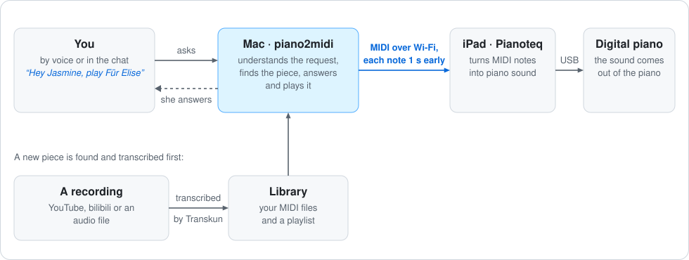
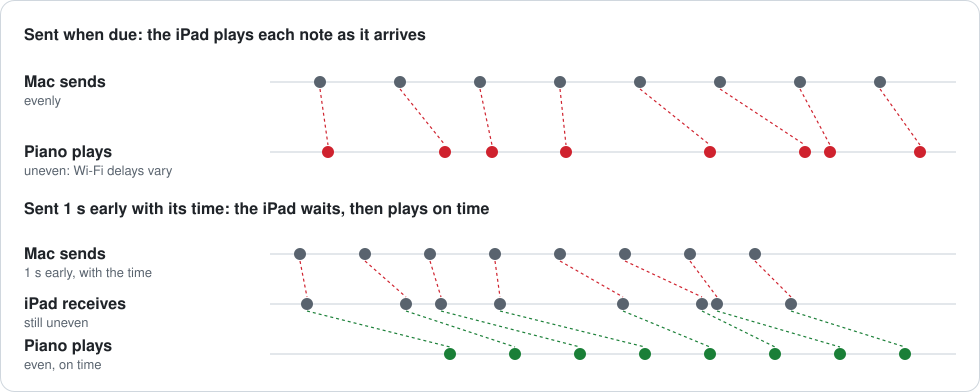

<h1 align="center">piano2midi</h1>

<p align="center">
  Piano recordings in, performance MIDI out, and back to a piano.<br>
  Notes, timing, velocity and sustain pedal, kept in a library you can ask for by chat or by voice.
</p>

<p align="center">
  
</p>

piano2midi turns a piano recording into a performance MIDI file with
[Transkun](https://github.com/Yujia-Yan/Transkun): a video from YouTube, bilibili or any of the
many other sites [yt-dlp](https://github.com/yt-dlp/yt-dlp) supports, or an audio file of your
own. The files go into a local library. You can then ask for a piece in plain language, typed or
spoken, and hear it on your piano: played by Pianoteq on an iPad that drives a digital piano, by
the digital piano's own sound, or by Pianoteq on the same Mac.

## Quick start

```bash
./setup.sh                  # once, then follow Setup below
./run.sh chat               # type "play Clair de Lune"
./run.sh voice              # or say "Hey Jasmine, play Clair de Lune"
```

## Transcription demo

<p align="center">
  
</p>

**Glenn Gould: J.S. Bach, Partita No. 2 in C minor, BWV 826 (rehearsal recording)**

<table>
  <tr>
    <th width="50%">Original recording</th>
    <th width="50%">Transcription, played in Pianoteq 9</th>
  </tr>
  <tr>
    <td valign="top">
      <video src="https://github.com/user-attachments/assets/4d7ad6ef-2430-4907-9b99-27893429c51e" width="100%" controls></video>
    </td>
    <td valign="top">
      <video src="https://github.com/user-attachments/assets/66c23753-2c38-4d77-9b6e-b4bc9aa24dfe" width="100%" controls></video>
    </td>
  </tr>
  <tr>
    <td><sub>Source: <a href="https://www.youtube.com/watch?v=WqwZC-yLYI4">Glenn Gould Official Channel on YouTube</a>.</sub></td>
    <td><sub>NY Steinway D Classical preset, on iPad. Full length, with sound.</sub></td>
  </tr>
</table>

| Audio | Notes | Velocity | Sustain pedal | Settings | Time |
|---|---|---|---|---|---|
| 1 min 47 s | 1,229 | 36–93 | 1 short press | default, no manual edits | about 1 min on 2 CPU cores |

Gould plays this music almost without pedal, and the transcription reflects that. Download the MIDI: [`demo/gould-partita-2-rehearsal.mid`](demo/gould-partita-2-rehearsal.mid)

## Setup

Five steps the first time; step 5 is only for the voice assistant.

### 1. Install

Requires Python 3.10+ (or [uv](https://docs.astral.sh/uv/)). Transcription runs on macOS or
Linux; playback with exact timing and the voice assistant are made for macOS. YouTube downloads
also need [Deno](https://deno.com), or a Node.js runtime explicitly enabled for yt-dlp.
If uv and Deno were installed in their default user directories, keep both on your PATH:

```bash
export PATH="$HOME/.local/bin:$HOME/.deno/bin:$PATH"
```

Add that line to your shell profile so new terminals can find them. From the project directory:

```bash
./setup.sh
```

Setup creates `.venv` and an empty `tasks.csv`, and checks that the transcription model loads.
ffmpeg comes with a dependency.

### 2. Add your keys

Keys go in your shell profile (`~/.zshrc` on a Mac), never in the repository. For the
recommended OpenAI setup, configure only the services you use:

| Key | Needed for | Where to get it |
|---|---|---|
| `OPENAI_API_KEY` | the chat model and, for voice, speech recognition | [platform.openai.com](https://platform.openai.com) > API keys |
| `YOUTUBE_API_KEY` | finding recordings on YouTube | [Google Cloud console](https://console.cloud.google.com): enable "YouTube Data API v3", then Credentials > Create API key |
| `ELEVENLABS_API_KEY` | her voice (optional, see step 5) | [elevenlabs.io](https://elevenlabs.io), under API keys in your account |

```bash
echo 'export OPENAI_API_KEY="..."' >> ~/.zshrc
echo 'export YOUTUBE_API_KEY="..."' >> ~/.zshrc
source ~/.zshrc
```

Without a YouTube key the chat still plays your library and recordings you link or point it to.
Anthropic is an optional alternative, not a setup requirement; see [Optional chat provider](#optional-chat-provider).
Local audio-to-MIDI transcription and direct MIDI playback do not need these cloud API keys.

### 3. Choose where the sound comes from

piano2midi plays by sending notes and pedal over MIDI, like someone playing a MIDI keyboard. Pick
one way and set it up once:

| | Sound | Connection | Settings |
|---|---|---|---|
| **A** | A network MIDI instrument, such as Pianoteq on an iPad | Mac → network MIDI → receiving device → digital piano | `PIANO2MIDI_PORT` |
| **B** | The piano's own sound | Mac paired with the piano's Bluetooth MIDI | `PIANO2MIDI_PORT`, `PIANO2MIDI_LEAD=0` |
| **C** | The piano's own sound | USB cable from the Mac to the piano | `PIANO2MIDI_PORT`, `PIANO2MIDI_LEAD=0` |
| **D** | Pianoteq on the same Mac | IAC Driver, inside the Mac | `PIANO2MIDI_PORT=IAC`, `PIANO2MIDI_LEAD=0` |

**A. Pianoteq on an iPad (the iPad can stay connected to the piano by USB)**

1. Open Pianoteq on the iPad.
2. On the Mac, open Audio MIDI Setup, choose Window > Show MIDI Studio, and click the globe
   button to open MIDI Network Setup.
3. Under My Sessions, click +, name the session `piano2midi` and tick it. Leave Latency at 0 ms.
4. Select the iPad under Sessions and Directories and click Connect. It now shows under
   Participants.
5. In Pianoteq on the iPad, enable the network session as a MIDI input.

Run `./run.sh play --ports` and use the actual output name. Depending on macOS, the port
may still be called `Network RTP Session 1` even after changing the session's local name.
For that output, add this setting to your shell profile and open a new terminal:

```bash
export PIANO2MIDI_PORT="Network RTP Session 1"
```

**After a restart or network interruption:** open the receiving instrument app, select the device
in MIDI Network Setup, and click Connect. Check that it appears under Participants. Each time
playback starts or continues, and about once a second while a piece plays, the Mac checks that the
output is there and, for a network session, that a device has joined it (Participants): the iPad
drops out when Pianoteq closes or the iPad goes offline, while the session's output stays. If the
piano is not there, the piece waits where it stopped: voice and iPhone Voice say so at once, chat
when you next ask to play. Once the device is back, the piece plays on from there.
`./run.sh play --ports` shows how many participants a network session has.

If a playback attempt fails, the piece and intended starting position are retained. After
connecting manually, ask to retry. Continue resumes the saved position; an explicit request to
start over begins at zero. There is no need to restart chat, voice or iPhone Voice just to retry
the connection. The Mac cannot confirm whether the receiving app's audio is audible or its cable
to the piano is connected.

**B. The piano's own sound, over Bluetooth**

1. Turn on Bluetooth MIDI on the piano (see its manual).
2. On the Mac, open Audio MIDI Setup, choose Window > Show MIDI Studio and click the Bluetooth
   button. Click Connect next to the piano. Pair it here, not in System Settings, which connects
   Bluetooth audio instead.

**C. The piano's own sound, over USB**

1. Connect the Mac to the piano's USB port. If an iPad uses that port, unplug it first.

**D. Pianoteq on the same Mac**

1. In Audio MIDI Setup > Window > Show MIDI Studio, double-click IAC Driver and tick "Device is
   online".
2. In Pianoteq, enable "IAC Driver Bus 1" as a MIDI input.

For B, C and D, find the output's name and keep it in your profile. Any part of the name will
do. A Roland FP-40, for example, shows up as `FP-40 MIDI Bluetooth` over Bluetooth and
`Roland Digital Piano` over USB:

```bash
./run.sh play --ports                                  # lists the MIDI outputs
echo 'export PIANO2MIDI_PORT="FP-40"' >> ~/.zshrc      # part of the name you chose
echo 'export PIANO2MIDI_LEAD=0' >> ~/.zshrc
source ~/.zshrc
```

`PIANO2MIDI_LEAD=0` is there because only Wi-Fi needs notes sent early (see
[Playback](#playback)). To try another way for a single run, put the settings in front of the
command, for example `PIANO2MIDI_PORT=Roland PIANO2MIDI_LEAD=0 ./run.sh voice`.

### 4. Test

The repository includes a demo MIDI file, so you can test before your library has anything in
it:

```bash
./run.sh play demo/gould-partita-2-rehearsal.mid
```

It prints `Playing on ...` with the output it found, and the piano should start within about a
second. Control+C stops it. Then try the chat: `./run.sh chat`.

### 5. Voice (optional)

Install the voice extras once:

```bash
uv pip install --python .venv/bin/python -e ".[voice]"    # or: .venv/bin/python -m pip install -e ".[voice]"
```

For her voice, add your ElevenLabs key and a voice ID. Copy the ID from a voice under My Voices
on elevenlabs.io; voices from the shared library need paid credits. If you speak more than one
language, list them:

```bash
echo 'export ELEVENLABS_API_KEY="..."' >> ~/.zshrc
echo 'export PIANO2MIDI_VOICE_ID="..."' >> ~/.zshrc
echo 'export PIANO2MIDI_LANGUAGES=zh,en' >> ~/.zshrc     # optional
source ~/.zshrc
./run.sh voice --greetings     # she says each greeting once
./run.sh voice                 # the first run asks for microphone access
```

A Mac mini needs an external microphone, such as a USB camera microphone or a headset. Choose
the input and output in System Settings > Sound. You can check the selected devices with
`.venv/bin/python -m sounddevice`; grant microphone access to Terminal when macOS asks.

Without ElevenLabs the macOS voice speaks, greetings included. The first run
downloads two small models (about 34 MB) into `output/.cache/models`. To give her other names,
see [Her name](#her-name).

Tip: to run piano2midi from any folder, add an alias to your profile, for example
`alias p2m="$HOME/Documents/piano2midi/run.sh"`, then use `p2m chat`, `p2m voice` and so on.

## Chat

```bash
./run.sh chat
```

Ask for a piece in plain language, in English, Chinese or another language; the assistant
answers in yours. It looks in the library first. If the piece is not there, it searches YouTube
for a real performance where the piano carries the music (solo piano first, then piano with
voice, never a band mix or a remix, and no falling-notes videos or tutorials), transcribes it,
saves it and plays it. If no good piano version exists, it says so. When a request is unclear,
it asks.

Examples: "I'd like to hear Chopin's Nocturne Op. 9 No. 2 by Rubinstein", "something gentle by
Debussy", "play ~/Music/my-recording.m4a". You can also paste a video link (YouTube, bilibili or
another site yt-dlp supports) to use that recording directly. For a long list of links, use
`tasks.csv` (see [Transcribe](#transcribe)).

| Command | What it does |
|---|---|
| `/play` ▶ | continue after a pause, or start the current piece again |
| `/pause` ⏸ | pause and keep the position |
| `/stop` ⏹ | stop and go back to the beginning |
| `/library [words]` | list or search the library |
| `/import <folder>` | add MIDI files |
| `/enrich` | fill in composers and other-language titles |
| `/new` | start a new conversation |
| `/quit` | exit (Control+C only interrupts a request) |

Plain language works too: "stop playing" pauses, "continue" picks up where it paused, "start
over" plays from the beginning, and asking for another piece replaces the current one.
A connection failure keeps the pending piece and its intended position; after reconnecting,
ask to retry. Waiting for a connection keeps the position, while explicitly cancelling the
request clears the pending selection.

## Models and response flow

These are the project defaults used in the tested Mac mini setup. Shell settings can override
the chat, speech-recognition and speech-output models; the chat/voice startup banner shows the
active selections.

| Task | Model or engine | Runs on | Recommendation |
|---|---|---|---|
| Understand requests, choose pieces and call playback tools | OpenAI [`gpt-6-luna`](https://developers.openai.com/api/docs/models/gpt-6-luna) | OpenAI API | Keep the tested default for this focused assistant. |
| Turn your spoken request into text | OpenAI [`gpt-transcribe`](https://developers.openai.com/api/docs/models/gpt-transcribe) | OpenAI API | Keep the default; set `PIANO2MIDI_LANGUAGES=zh,en` for Chinese and English hints. |
| Speak replies and greetings | ElevenLabs `eleven_v4_turbo` | ElevenLabs API | Keep the tested voice and model; macOS speech is the fallback. |
| Convert a piano recording into MIDI | Transkun `2.0.1`, pretrained `2.0` | This Mac, CPU by default | Keep CPU mode on the Mac mini; Apple MPS is opt-in. |
| Detect the wake words | sherpa-onnx bilingual keyword-spotting model | This Mac | No cloud key needed. |
| Detect speech and silence | Silero VAD through sherpa-onnx | This Mac | No cloud key needed. |

A spoken request follows this path: local wake word and recording → OpenAI speech recognition
→ chat and library lookup → search/download and local transcription if needed → connection
check → spoken introduction → MIDI playback. Existing library pieces skip download and
transcription. Network calls and local transcription both contribute to the wait, so response
time varies. The Mac is not running the OpenAI or ElevenLabs models locally.
Before online search or preparation, she acknowledges the wait without promising a completion time.

The recommendation is to keep this working combination rather than change models during
normal use. A stronger chat model is optional and does not replace reliable playback state or
connection handling. No local language model, Claude Code installation or extra GPU is required
for this setup.

### Optional chat provider

The code also supports Anthropic for chat. `ANTHROPIC_API_KEY` is needed only if you choose
that provider; it is not used by the tested OpenAI setup. The project's Anthropic default is
`claude-haiku-5-5`. To explicitly select it, set
`PIANO2MIDI_MODEL=anthropic:claude-haiku-5-5` and supply your own Anthropic API key.
Voice recognition still needs `OPENAI_API_KEY`. Claude Code is a separate development tool and
is not required to run piano2midi. This alternative has not been part of the Mac mini validation.

## Voice

```bash
./run.sh voice
```

Say "Hey Jasmine", or her Chinese name 小茗同学, and ask for a piece. Say it in one
breath ("Hey Jasmine, stop"), or pause after the name: she greets you in the language of the name
you used, then listens. Anything that is playing pauses while you speak and continues
afterwards, unless you asked to stop or for something else. "Stop", "continue" and "start over"
(also in Chinese) act at once; everything else goes to the same assistant as the chat, and she
speaks the answer while it is still being made. After a reply you can go on without her name for
eight seconds, but not while the piano plays, whose sound would be taken for speech; otherwise,
or after "再见" / "bye", she waits for her name again. Control+C quits. The terminal shows what she
heard and what she said.

Successful pause, continue and restart requests get a short acknowledgment. The assistant
speaks as a musical companion playing for you, with small variations in the control replies;
recording and performer credits stay accurate. Calling only her name gets a local greeting,
without a model-wait acknowledgment or a second greeting in the same listening turn. Failed
playback produces the connection reminder instead of a success acknowledgment. Short commands
use local replies without an extra model call.

### Her name

She answers to "Hey Jasmine" and to 小茗同学. Speech recognition hears only the sound of a name, so
whatever characters it writes for 小茗同学 (小明同学, say) are shown and passed on as 小茗同学. To give
her other names, list one or more, separated by commas:

```bash
echo 'export PIANO2MIDI_WAKE_WORDS="Hey Maestro,Hey Piano"' >> ~/.zshrc
```

- Write a Chinese name in Chinese characters; any name works, with no training. English names
  must use words from the pronouncing dictionary; if one is unknown, `./run.sh voice` says so
  when it starts.
- The names are hers too: she calls herself by them (without "Hey"), and she greets you in
  Chinese when you call her by a Chinese name, in English otherwise.
- Good names have three to five syllables and are not words you say often. A short English name
  works better with "Hey" in front.
- If she often misses you, run `./run.sh voice --debug` to see what she hears, and lower
  `PIANO2MIDI_WAKE_THRESHOLD` (default `0.2`, for example to `0.15`); if she wakes by herself,
  raise it. If you say an English name differently from the dictionary, add your way to
  `EXTRA_PRONUNCIATIONS` in `voice.py`, as "Jasmine" also accepts "jas-MEEN".

### Her voice and greetings

- **Voice:** the ElevenLabs voice in `PIANO2MIDI_VOICE_ID` (see [Setup](#setup), step 5). The
  default model is `eleven_v4_turbo`; `PIANO2MIDI_TTS_MODEL=eleven_v4` is richer and slower.
- **Greetings:** what she says when you pause after her name, a few lines each in Chinese and
  English, picked at random. Change the lines in `GREETINGS` in `voice.py`, and how they are said
  (a little livelier than her answers) in `GREETING_SETTINGS`. They are made once with her voice
  and kept in `output/.cache/voice`, and made again when you change them. Hear them all with
  `./run.sh voice --greetings`.

After a piece finishes naturally, she leaves one second after the last scheduled MIDI events,
then says a short, randomly chosen closing line. Pausing, stopping, changing pieces or failed
playback does not trigger a closing line. Replies use the language of the latest request.
While the chat model is taking longer than about three seconds, a short acknowledgment can
fill the silence once. Playback introductions are spoken after the connection check and before
the music starts. Diagnostic messages stay in the terminal; connection failures get a brief,
nontechnical spoken reminder.

### How it listens

- **Wake words:** heard on the computer by [sherpa-onnx](https://github.com/k2-fsa/sherpa-onnx)
  keyword spotting.
- **When you have finished:** [Silero](https://github.com/snakers4/silero-vad) voice activity
  detection tells your voice from silence and the piano, so the music or her own greeting is not
  taken for your request.
- **What you said:** OpenAI `gpt-transcribe`, with your library's titles and names as spelling
  hints and the languages in `PIANO2MIDI_LANGUAGES`.

`./run.sh voice --debug` also shows each time she hears her name, and which one.

## iPhone Voice

The same voice assistant, with your iPhone as her microphone and speaker. The page is a single
orb: gray when off or paused, in color while she listens, moving with your voice and hers.

<p align="center">
  
</p>

It runs in your home network: the page comes from your Mac, and the phone talks only to the Mac.
As with `./run.sh voice`, what you say after her name goes to OpenAI for recognition, and her
replies to ElevenLabs.

### Set up the iPhone (once)

The Mac and the iPhone need the same Wi-Fi. Safari lets a page use the microphone only over trusted
HTTPS, so the Mac makes its own small certificate authority, and the iPhone is told once to trust it.

1. **Install** the page's server. It uses the keys and voice settings from [Setup](#setup),
   step 5:

   ```bash
   uv pip install --python .venv/bin/python -e '.[web-voice]'
   ```

2. **Start it** on the Mac:

   ```bash
   ./run.sh web-voice
   ```

   It prints the page's address on its `address` line, with the Mac's network address in it, for
   example `https://192.168.1.20:8765/#token=...`. If macOS asks whether Python may accept
   incoming connections, allow it. Control+C stops it.

3. **Trust the Mac on the iPhone.** The first start also makes
   `output/.cache/phone-tls/piano2midi-CA.cer`, shows it in Finder and lists these steps. AirDrop
   that file, and only that one, to the iPhone (right-click → Share → AirDrop), and install it in
   Settings → General → VPN & Device Management. Then turn on full trust for it ("piano2midi on"
   and the Mac's name) in Settings → General → About → Certificate Trust Settings.

4. **Open the page** at the printed address in Safari on the iPhone. Share → **Add to Home
   Screen** makes it an app that keeps this address. Open the app, tap the orb and allow the
   microphone.

After that, start the server and open the app. Every start makes a fresh certificate for the Mac's
current network address, so the iPhone never needs the certificate again. If the router gives the
Mac a new address, the printed address changes with it; add the new one to the Home Screen. A DHCP
reservation for the Mac in the router keeps the address fixed, as long as the Mac's Private Wi-Fi
Address for that network (System Settings → Wi-Fi → Details) is not set to Rotating. The page is
opened at the address rather than at the Mac's `.local` name because Safari does not keep the
microphone permission for `.local` names, and would ask every time. For another iPhone,
`open -R output/.cache/phone-tls/piano2midi-CA.cer` shows the file again.

**Keep private:** the `.pem` files and the token, all in `output/`, which is never committed. With
the token, anyone on your Wi-Fi could use the page. The certificate authority can vouch only for
`.local` names and home network addresses, so even its key could not pass anything off as a
website. `piano2midi-CA.cer` holds no secret. To start afresh, delete `output/.cache/phone-token`
(a new address, to add to the Home Screen again) or `output/.cache/phone-tls/` (a new certificate
authority, to install again).

### Using it

- **Tap the orb** to start. It is half colored while it starts (more taps do not cancel it), then
  turns to color with a start sound. From then on it is the same conversation as
  `./run.sh voice`, the same code, with the phone as her ears and voice.
- **Tap again to pause.** She stops listening and speaking at once, and the piano about a second
  later, once the notes already sent have played (see [Playback](#playback)). A task in progress
  finishes only its current step; the microphone is released after the end sound. Tap to continue
  from the same place in the same conversation.
- **Closing the page**, locking the phone or switching apps ends the conversation and stops the
  music. The orb is gray again the next time.

The Mac does the rest, with the same keys and settings as `./run.sh voice`: it listens for her
name, sends what follows it to speech recognition, asks the assistant, and sends her voice to the
phone while it is being made. Nothing is played on the Mac's speakers and its microphone is not
used; the piano plays through your usual MIDI route. One phone at a time, and not alongside
`./run.sh voice` or `./run.sh chat`. You cannot interrupt her by speaking, but a tap pauses her.
The page has to stay in front; it keeps the screen on while it is connected, and does not zoom or
scroll. In portrait the iPhone still shows its status bar, which only native apps can hide.
`--debug` shows each time she hears her name, as with `./run.sh voice --debug`.

## Playback

```bash
./run.sh play someone like you    # best match in the library
./run.sh play path/to/file.mid
./run.sh play --all               # the whole playlist, in order
./run.sh play --ports             # list MIDI outputs
```

`--port` and `--lead` override `PIANO2MIDI_PORT` and `PIANO2MIDI_LEAD` for one run. Only notes and
controllers are sent, so the sound settings on the receiving end stay as they are. Pausing or
stopping lifts all keys and the pedal, and continuing puts the pedal back where it was.
Control+C stops `play`.

Wi-Fi delivers notes unevenly, which breaks the rhythm. So on a Mac each note leaves one second
early, together with the time it should sound, and the iPad plays it on time:

<p align="center">
  
</p>

In return, playback starts, pauses and stops about one second after you ask. Set
`PIANO2MIDI_LEAD` in seconds to change the lead: `2` for an unsteady network, `0.5` for a quicker
response, `0` to send each note when it is due, as over Bluetooth or USB. `--timing` reports how
punctually this computer sent the notes.

If nothing sounds, check the connection rather than the program. For the iPad, it must still be
listed under Participants in MIDI Network Setup (the session can drop when a computer sleeps),
with Pianoteq open. For Bluetooth, the piano must show as connected in Audio MIDI Setup. After
reconnecting, ask chat, voice or iPhone Voice to retry; the pending piece and position are kept.

## Transcribe

Add video URLs to `tasks.csv`, one per row (only the `url` column is required), then run:

```bash
./run.sh
```

MIDI files go to `output/MIDI Files/`, named after the video titles, and into the library.
Add an optional `name` column to choose your own titles. Completed rows are skipped; run the
same command again to retry failures or resume after an interruption. Work files (the original
audio, raw MIDI and statistics) stay in the hidden `output/.cache/` folder. Do not edit the CSV
while it is running.

Other ways to run it:

```bash
./run.sh /path/to/song.mp3                           # local audio files or folders
./run.sh --csv tasks.csv --overwrite                 # transcribe again, reusing the downloaded audio
./run.sh /path/to/recordings -o ~/Desktop/out        # write somewhere else, outside the library
./run.sh --csv tasks.csv --device cpu --threads 2    # choose the device and CPU threads
```

CSV columns are `url,name,status,audio_path,midi_path,error`. Status is `pending`, `processing`,
`done` or `failed` (blank means pending). Exit codes are 0 for success, 1 for task failures,
2 for task-list or usage errors and 130 for interruption.

By default, cleanup trims same-pitch overlaps, removes soft-pedal events and makes sure the
sustain pedal is released at the end. `--legato`, `--keep-soft-pedal` and `--pedal-ramps` change
that; see `./run.sh --help`.

## Library

The library is one file, `output/library.db`, with the MIDI files in `output/MIDI Files/`.
`output/MIDI Files/playlist.m3u` lists everything in the order it was added and is kept up to
date. MIDI files you put into that folder yourself are added the next time the chat or the voice
assistant starts.

```bash
./run.sh library list
./run.sh library import ~/Desktop/midi    # copy existing MIDI files in (--in-place to leave them)
./run.sh library enrich                   # add composers, other-language titles and tags
```

## Settings

Set these in your shell profile; [Setup](#setup) says which ones you need.

| Variable | Default | Used for |
|---|---|---|
| `OPENAI_API_KEY` | | chat model and speech recognition |
| `PIANO2MIDI_MODEL` | `openai:gpt-6-luna` | chat model |
| `YOUTUBE_API_KEY` | | searching YouTube from the chat |
| `PIANO2MIDI_PORT` | `piano2midi` | MIDI output, by part of its name |
| `PIANO2MIDI_LEAD` | `1` | seconds each note leaves early (macOS) |
| `PIANO2MIDI_WAKE_WORDS` | `小茗同学,Hey Jasmine` | wake words |
| `PIANO2MIDI_WAKE_THRESHOLD` | `0.2` | wake word sensitivity (lower hears more) |
| `PIANO2MIDI_LANGUAGES` | | languages you speak, e.g. `zh,en` |
| `PIANO2MIDI_STT_MODEL` | `gpt-transcribe` | speech recognition model |
| `ELEVENLABS_API_KEY` | | her voice |
| `PIANO2MIDI_VOICE_ID` | | which ElevenLabs voice |
| `PIANO2MIDI_TTS_MODEL` | `eleven_v4_turbo` | ElevenLabs model |

## Limits and maintenance

Works best on solo piano. There is no vocal or accompaniment separation, so the assistant looks
for piano-led recordings, and transcription may miss notes or predict incorrect ones. The sustain
pedal is on or off. Recordings are limited to 60 minutes, which fits even the longest sonatas;
longer videos are not offered by the search and are refused before downloading.
Run one of chat, voice and iPhone Voice at a time: each controls the same piano on its own.
Download only individual videos you are permitted to access and download.
Playlist expansion, live streams and bypassing access restrictions are not supported. Website
support depends on yt-dlp; download failures are recorded in the CSV. To update the downloader:

```bash
uv pip install --python .venv/bin/python --upgrade 'yt-dlp[default]'
```

The project and library can live on a dedicated Mac mini at `~/Documents/piano2midi` when
Documents is not cloud-synced. Keep the working copy outside cloud-synced folders if Documents
synchronization is enabled. The library is local and is not synchronized with another Mac or
uploaded with code; back up both `output/library.db` and `output/MIDI Files/`. A live
database should be copied with SQLite's backup API. Keys remain in your shell profile.
Launching chat or voice is manual; no login item, background connection service or automatic
startup is installed.

## License and credits

piano2midi is MIT licensed. Transcription uses
[Transkun](https://github.com/Yujia-Yan/Transkun). Its pretrained weights were trained on the
MAESTRO dataset (CC BY-NC-SA 4.0); check the applicable terms before commercial use. The voice
assistant uses [sherpa-onnx](https://github.com/k2-fsa/sherpa-onnx) keyword spotting and
[Silero VAD](https://github.com/snakers4/silero-vad).

## Checks

Run offline checks with `.venv/bin/python -m unittest discover -s tests`. The iPhone Voice checks
also need `uv pip install --python .venv/bin/python httpx`, and its page has its own, run with
Node.js: `for test in tests/test_web_*.js; do node "$test"; done`. None of them uses paid APIs, a
microphone or a MIDI device.
For a user-run real-model check, run `.venv/bin/python tests/manual_playback_intents.py`.
It tests 16 utterances against a temporary library and simulated playback; it does not use
the microphone, speak, play actual MIDI, or change the production library. It uses the configured
chat model and account. `--list` lists the cases without any API calls. Hardware playback, real
microphone recognition and iPhone Voice on a real phone (wake accuracy, audio routing, the start
and end sounds) still need a separate end-to-end check.

Playback tools separate selection from current-piece control: `play_recording(id)` accepts only
IDs offered by library search or transcription in the current request; `control_playback(action)`
accepts no recording ID. Chat and voice share the same execution path and the application's
current/pending playback state. Invalid selections are returned to the model for correction
without overwriting the existing piece. Exact short commands are handled locally; natural
requests use the model rather than an expanding set of phrase-matching rules.
