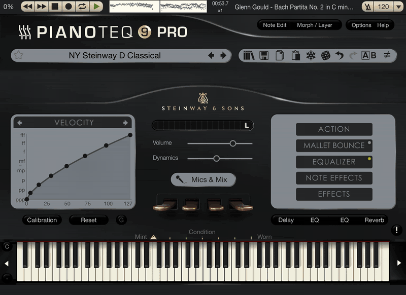

<h1 align="center">piano2midi</h1>

<p align="center">
  Solo piano recording in, performance MIDI out.<br>
  Notes, timing, velocity and sustain pedal, ready for Pianoteq or a self-playing piano.
</p>

<p align="center">
  
</p>

<p align="center">
  <sub>Glenn Gould's rehearsal of Bach's Partita No. 2, transcribed by piano2midi and played back in Pianoteq 9 (20-second excerpt).</sub>
</p>

## Demo

**Glenn Gould: J.S. Bach, Partita No. 2 in C minor, BWV 826 (rehearsal recording)**

<table>
  <tr>
    <th width="50%">Original recording</th>
    <th width="50%">Transcription, played in Pianoteq 9</th>
  </tr>
  <tr>
    <td valign="top">
      <video src="https://github.com/user-attachments/assets/4d7ad6ef-2430-4907-9b99-27893429c51e" width="100%" controls></video>
    </td>
    <td valign="top">
      <video src="https://github.com/user-attachments/assets/66c23753-2c38-4d77-9b6e-b4bc9aa24dfe" width="100%" controls></video>
    </td>
  </tr>
  <tr>
    <td><sub>Source: <a href="https://www.youtube.com/watch?v=WqwZC-yLYI4">Glenn Gould Official Channel on YouTube</a>.</sub></td>
    <td><sub>NY Steinway D Classical preset, on iPad. Full length, with sound.</sub></td>
  </tr>
</table>

| Audio | Notes | Velocity | Sustain pedal | Settings | Time |
|---|---|---|---|---|---|
| 1 min 47 s | 1,229 | 36–93 | 1 short press | default, no manual edits | about 1 min on 2 CPU cores |

Gould plays this music almost without pedal, and the transcription reflects that. Download the MIDI: [`demo/gould-partita-2-rehearsal.mid`](demo/gould-partita-2-rehearsal.mid)

## Quick start

1. Add video URLs to `tasks.csv`, one per row. Only the `url` column is required:

   ```csv
   url
   https://www.youtube.com/watch?v=VIDEO_ID
   ```

2. Run from the project directory:

   ```bash
   ./run.sh
   ```

3. Find your MIDI files in `output/MIDI Files/`. Filenames use video titles
   automatically; add an optional `name` column to choose your own titles.

The runner fills in task status and file paths. Completed tasks are skipped.
Run the same command again to retry failures or resume after an interruption.
Each finished MIDI is also added to the local library and its playlist (see
[Chat](#chat)). Work files stay in the hidden `output/.cache/` folder: the original
audio (no intermediate MP3), raw MIDI and statistics. Do not edit the CSV while
it is running, and run only one process per task list.

## Installation

Requires macOS or Linux and Python 3.10+ (or uv). Run from the project directory:

```bash
./setup.sh
```

Setup creates an empty `tasks.csv` without overwriting an existing list. ffmpeg
is provided by a dependency. YouTube downloads also require an installed Deno
or Node.js runtime. Your `tasks.csv` and generated files in `output/` are excluded
from Git.

## Other options

```bash
# Choose a task list, device and CPU thread count
./run.sh --csv tasks.csv --device cpu --threads 2

# Transcribe again while reusing valid cached audio
./run.sh --csv tasks.csv --overwrite

# Convert local audio files or folders; no input directory is required
./run.sh /path/to/song.mp3

# Write MIDI and work files to another folder, outside the library
./run.sh /path/to/recordings -o ~/Desktop/transcriptions
```

CSV columns are `url,name,status,audio_path,midi_path,error`; only `url` is required.
Status is `pending`, `processing`, `done` or `failed`; a blank status means pending.
Keep generated path columns to resume tasks. Add a new row when changing a URL.
Paths are stored relative to the CSV's directory. Assigned output paths stay fixed
on retries; new tasks use the directory selected with `-o` (default `output/.cache`).
Exit codes are 0 for success, 1 for task failures, 2 for task-list or usage errors,
and 130 for interruption.

By default, cleanup trims same-pitch overlaps, removes soft-pedal events and
ensures the sustain pedal is released at the end. Use `--legato`,
`--keep-soft-pedal` and `--pedal-ramps` to adjust the behavior. See `./run.sh --help`.

## Chat

Ask for a piece in plain language, in English, Chinese or another language; the
assistant answers in yours. It checks your local library first. If nothing matches,
it searches YouTube, picks a real performance (it avoids falling-notes videos,
tutorials and easy arrangements), runs it through the CSV flow above, saves the MIDI
in `output/MIDI Files/` and plays it (see [Playback](#playback)). Ask how it chose
or where a file is, and it tells you.

Set the keys once. They stay in your shell profile, never in the repository:

```bash
echo 'export OPENAI_API_KEY="..."' >> ~/.zshrc     # or ANTHROPIC_API_KEY
echo 'export YOUTUBE_API_KEY="..."' >> ~/.zshrc    # YouTube Data API v3
source ~/.zshrc
```

Then run:

```bash
./run.sh chat
```

Example requests: "I'd like to hear Chopin's Nocturne Op. 9 No. 2 by Rubinstein",
"something gentle by Debussy", "play ~/Music/my-recording.m4a".
You can also paste a video link (YouTube, bilibili or another site yt-dlp supports)
to use that recording directly, without a search. For a long list of links, use
`tasks.csv` instead.
In the chat, `/library` lists or searches the library, `/import <folder>` adds MIDI
files, `/enrich` fills in composers and other-language titles, `/new` starts over
and `/quit` exits. Control+C does not end the chat.

The default model is OpenAI `gpt-6-luna`, or Claude Haiku 5.5 when only
`ANTHROPIC_API_KEY` is set. Choose another with, for example,
`export PIANO2MIDI_MODEL=anthropic:claude-haiku-5-5`.

The library is a single file, `output/library.db`. Manage it from the terminal:

```bash
./run.sh library import ~/Desktop/midi    # copy existing MIDI files in
./run.sh library list
./run.sh library enrich                   # add composers, aliases and tags
```

MIDI files you place in `output/MIDI Files/` yourself are added when the chat starts.
`output/MIDI Files/playlist.m3u` lists the whole library in the order it was added and
is kept up to date. The chat deletes its own downloads once a MIDI is saved.
Everything under `output/` stays out of Git.

## Playback

piano2midi can play library pieces on Pianoteq by sending the notes and pedal
over MIDI, as if someone were playing a MIDI keyboard. Pianoteq can run on the
same Mac or on an iPad on the same Wi-Fi; the iPad can stay connected to a
digital piano by USB, so the sound comes out of the piano.

One-time setup for an iPad (macOS):

1. Open Pianoteq on the iPad.
2. On the Mac, open Audio MIDI Setup, choose Window > Show MIDI Studio, and
   click the globe button to open MIDI Network Setup.
3. Add a session under My Sessions, name it `piano2midi` and enable it.
4. Select the iPad under Sessions and Directories and click Connect.
5. In Pianoteq on the iPad, enable the network session as a MIDI input.

To use Pianoteq on the Mac instead, enable the IAC Driver in Audio MIDI Setup,
select it as Pianoteq's MIDI input, and add `--port IAC` (or set
`PIANO2MIDI_PORT=IAC`).

```bash
./run.sh play someone like you    # best match in the library
./run.sh play --all               # the whole playlist, in order
./run.sh play --ports             # list MIDI outputs
```

In the chat, playback works like a media player:

| Command | Button | What it does |
|---|---|---|
| `/play` | ▶ | continue after a pause, or start the current piece again |
| `/pause` | ⏸ | pause and keep the position |
| `/stop` | ⏹ | stop and go back to the beginning |

Plain language works too: "stop playing" pauses, "continue" picks up where it
paused, "start over" plays from the beginning, and asking for another piece
replaces the current one. When a piece ends, playback stops.

Only notes and controllers are sent, so the Pianoteq preset does not change.
Pausing or stopping lifts all keys and the sustain pedal; continuing puts the
pedal back where it was.

On a Mac, each note leaves one second early, together with the time it should
sound. The receiver holds it until then, so Wi-Fi hiccups do not disturb the
rhythm. In return, playback starts, pauses and stops about one second after you
ask. To change the lead, set `PIANO2MIDI_LEAD` in seconds: for example `2` for an
unsteady network, `0.5` for a quicker response, or `0` to send each note when it
is due. Leave Latency in MIDI Network Setup at 0 ms.

## Voice

Talk to the assistant instead of typing. Install the extras once, then run:

```bash
uv pip install --python .venv/bin/python -e ".[voice]"
./run.sh voice
```

Say "Hey Jasmine" (or its Chinese name, Xiaoming Tongxue) and ask for a piece. Say
it in one breath ("Hey Jasmine, stop"), or pause after the name: she answers ("Yes!
I'm right here!", in Chinese if you used the Chinese name), then listens. Anything
that is playing pauses while you speak and continues afterwards, unless you asked to
stop or for something else. "Stop", "continue" and "start over" (also in Chinese)
act at once; everything else goes to the same assistant as the chat.

- **Wake words:** heard on the computer by sherpa-onnx keyword spotting, which
  takes any name without training. Its model (about 33 MB) downloads on the first
  run. To use other names, list them, separated by commas: Chinese characters or
  English words, for example `export PIANO2MIDI_WAKE_WORDS="Hey Maestro"`. If it
  misses you, lower `PIANO2MIDI_WAKE_THRESHOLD` (default `0.2`); if it wakes by
  itself, raise it. `./run.sh voice --debug` shows which name it heard and when
  nothing was heard after it. English names are matched against a pronouncing
  dictionary, plus a few common non-native ways of saying them (see
  `EXTRA_PRONUNCIATIONS` in `voice.py`).
- **When you have finished:** Silero voice activity detection (a small model,
  downloaded once) tells your voice from silence and the piano, so the music or her
  own greeting is not taken for your request.
- **Listening:** OpenAI `gpt-transcribe`, with your library's titles and names as
  spelling hints. If you mix languages, list them, for example
  `export PIANO2MIDI_LANGUAGES=zh,en`.
- **Speaking:** ElevenLabs. Set `ELEVENLABS_API_KEY` and the voice to use,
  `PIANO2MIDI_VOICE_ID` (from My Voices on elevenlabs.io; voices from the shared
  library need paid credits). The default model is `eleven_v4_turbo`; set
  `PIANO2MIDI_TTS_MODEL=eleven_v4` for the richer, slower one. Without these
  settings the macOS voice is used. Her greetings are made once with this voice,
  a little brighter than her replies, and kept in `output/.cache/voice`; hear them
  all with `./run.sh voice --greetings` and change them in `GREETINGS` in
  `voice.py`. Without ElevenLabs she beeps instead.

The first run asks for microphone access.

## Limits and maintenance

Works best on solo piano. There is no vocal or accompaniment separation, and
transcription may miss notes or predict incorrect ones. Sustain pedal is on/off.
Download only individual videos you are permitted to access and download. Playlist
expansion, live streams and bypassing access restrictions are not supported.
Website support depends on yt-dlp; download failures are recorded in the CSV.
To update the downloader:

```bash
uv pip install --python .venv/bin/python --upgrade 'yt-dlp[default]'
```

## License and credits

piano2midi is MIT licensed. Transcription uses
[Transkun](https://github.com/Yujia-Yan/Transkun). Its pretrained weights were
trained on the MAESTRO dataset (CC BY-NC-SA 4.0); check the applicable terms before
commercial use.
