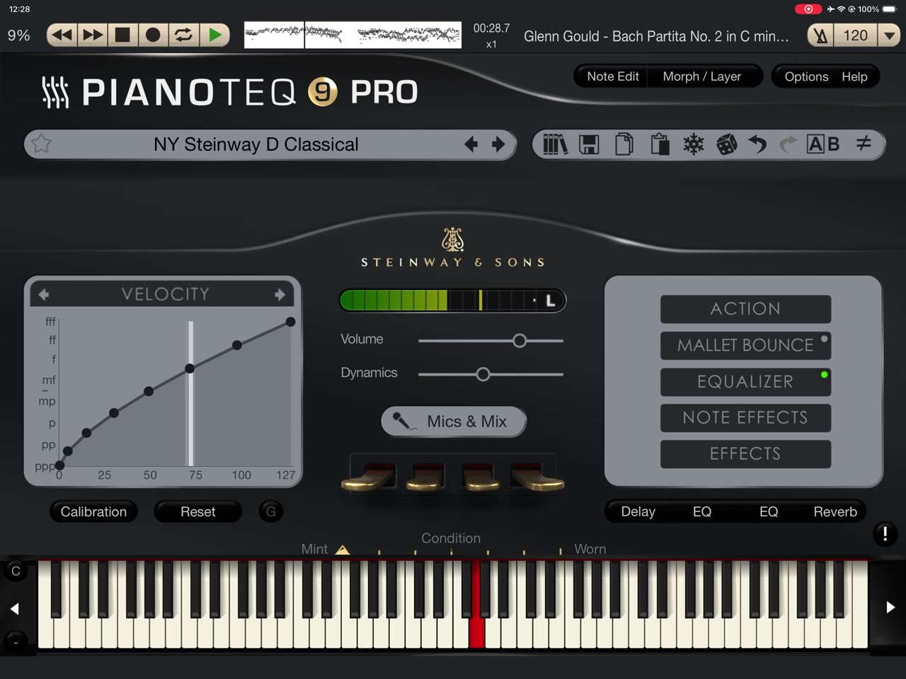

# piano2midi

Turn a solo piano recording (mp3, m4a, wav, flac) into a **performance MIDI**: every note with its real timing, velocity and release, plus the sustain pedal (CC64). Nothing is quantized, so rubato and voicing survive. The output is meant to be played back through a good piano engine such as Pianoteq, or by a self-playing piano.

Transcription is done by [Transkun](https://github.com/Yujia-Yan/Transkun) (Yan & Duan), a piano-specific model that predicts notes, velocities and pedals. piano2midi adds audio decoding, a small conservative clean-up, batch processing, a CLI and an HTTP API.

## Demo

**Glenn Gould: J.S. Bach, Partita No. 2 in C minor, BWV 826 (rehearsal recording)**

<table>
  <tr>
    <th>Original recording (YouTube)</th>
    <th>Transcribed MIDI played in Pianoteq 9</th>
  </tr>
  <tr>
    <td><a href="https://www.youtube.com/watch?v=WqwZC-yLYI4"></a></td>
    <td><a href="demo/gould-partita-2-pianoteq.mp4"></a></td>
  </tr>
</table>

Click an image to play it. Download the MIDI: [`demo/gould-partita-2-rehearsal.mid`](demo/gould-partita-2-rehearsal.mid). Playback uses the NY Steinway D Classical preset in Pianoteq 9 on iPad.

Default settings, no manual edits: 1 min 47 s of audio gave 1,229 notes with velocities from 36 to 93 and a single short pedal press (Gould plays this music almost without pedal). Transcription took about a minute on two CPU cores.

## Quick start (macOS / Linux)

```bash
git clone https://github.com/kaisenyao/piano2midi.git
cd piano2midi
./setup.sh                 # one time: creates .venv and installs everything (1–2 GB)
```

Then either:

- put audio files in `input/` and double-click **Convert.command** (macOS), or
- run `./run.sh path/to/song.mp3` (or `./run.sh input` for the whole folder).

MIDI files appear in `output/` with the same names. Files that were already converted are skipped, so you can keep adding music to `input/` and double-click again; pass `--overwrite` to convert them again.

```text
output/
  song.mid                 <- the file to play
  extras/song.raw.mid      <- untouched model output, for comparison
  extras/song.json         <- duration, note count, velocity range, pedal count, timing
```

## What the clean-up does (and does not do)

By default the model output is kept as is, except for three safety fixes. Onsets, pitches and velocities are never changed.

| Step | Default | Why |
|---|---|---|
| Same-pitch overlaps are trimmed | on | a key cannot be pressed twice without being released |
| Soft pedal (CC67) is dropped | on | its prediction is unreliable and it changes the tone of whole passages (`--keep-soft-pedal` to keep it) |
| Pedal released at the end | on | no hanging pedal |
| Melody gaps closed | off | `--legato`: holds the top voice 20 ms into the next note when the gap is ≤ 100 ms (notes 60–600 ms, never repeated notes). Useful for cantabile pieces; leave it off for detached playing, where it would erase the articulation (on Glenn Gould's Bach it would have changed ~18% of the notes) |
| Pedal ramps | off | `--pedal-ramps` replaces instant 0/127 jumps with ~50 ms foot travel |

Not done on purpose: quantization, velocity "humanizing" or rescaling, hand separation, score correction, source separation.

## Options

```text
piano2midi INPUT... [-o OUTPUT_DIR] [--overwrite] [--legato] [--keep-soft-pedal]
                    [--pedal-ramps] [--device auto|cpu|cuda|mps] [--threads N]
```

`--device auto` uses CUDA when available, otherwise CPU. CPU is reliable on Apple Silicon; `mps` is opt-in.

## HTTP API / cloud

```bash
pip install -e ".[api]"
uvicorn piano2midi.api:app --port 8000
curl -F file=@song.mp3 "http://localhost:8000/transcribe" -o song.mid
```

`GET /health`, `POST /transcribe` (multipart field `file`; optional query flags `legato`, `keep_soft_pedal`, `pedal_ramps`, all false by default). The response is the MIDI file; a summary is in the `X-Piano2MIDI-Info` header. A CPU `Dockerfile` is included. Requests are processed one at a time per process; on 2 CPU cores a recording takes about half to three quarters of its own length.

## Limits

- Works best on **solo piano**. Songs with vocals or a band will produce many wrong notes; there is no source separation yet.
- Pedal is on/off: half-pedaling is not recovered.
- Expect some missed soft inner notes and occasional wrong notes in dense passages. It is a performance transcription, not a score.
- Bring your own audio. This project does not download from streaming services.

## Development

```bash
.venv/bin/pip install -e ".[dev,api]"
.venv/bin/pytest
```

## Credits and licenses

- piano2midi: MIT (see `LICENSE`).
- Transkun: MIT, by Yujia Yan and Zhiyao Duan. The pretrained weights ship inside the `transkun` pip package and were trained on the MAESTRO dataset (CC BY-NC-SA 4.0); check those terms before any commercial use.
